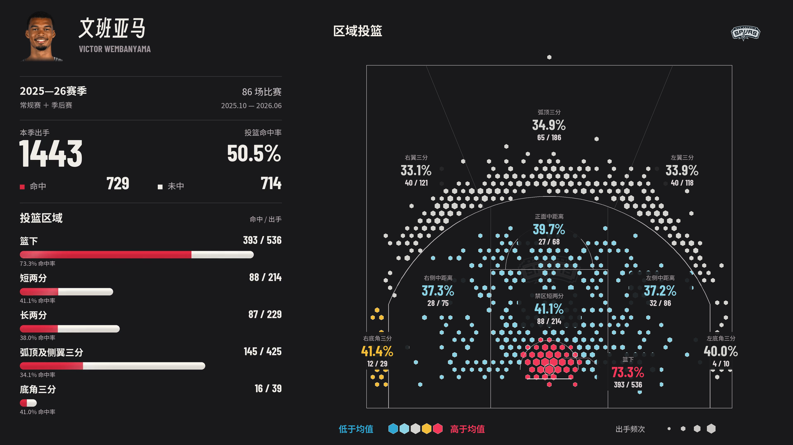
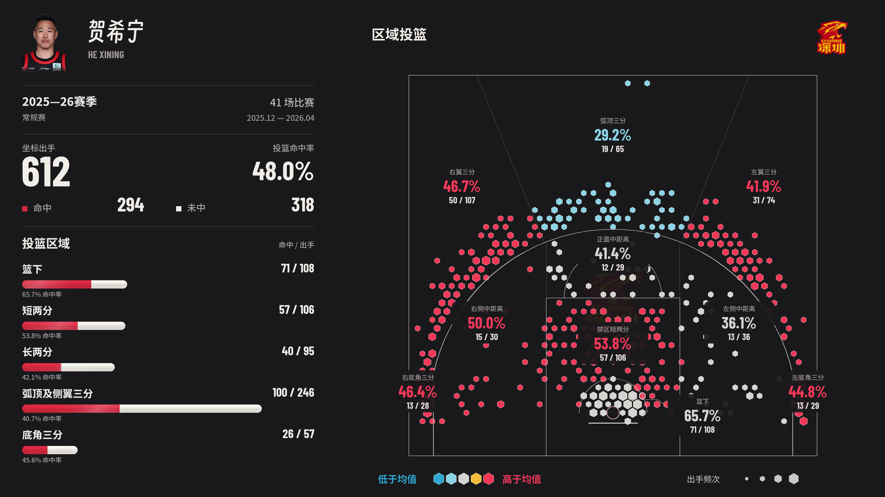

# NBA / CBA 投篮档案 · nba-shot-atlas

篮坛巨编的 NBA / CBA 球员投篮轨迹视频 Skill。输入中文或英文球员姓名，选择单个赛季或全部可用赛季，生成真实出手坐标驱动的横屏 MP4。

## v1.3.0：按场齐发与平滑统计

- 支持按实际出场范围制作，每场全部投篮同帧起弧、圈叉累积，场间默认停半秒。
- 三场示例投篮段5秒，另加2秒圈叉呼吸发光停留和6秒向右展开区域总结。
- 左栏数字逐个递增，柱条连续平滑增长；每批结束达到精确累计统计。
- 英文名在中文右侧，同一行淡色显示，按实际姓名宽度适配。
- 新增可执行 apply_game_batch.py 与 batch_motion.py，保留NBA/CBA及原有整季逐球模式、缓存优先与安全区。

调用示例：使用 $nba-shot-atlas，做灰熊杰罗姆本赛季常规赛前三场，每场齐发、间隔0.5秒，投篮段5秒。

## v1.2.1：日期精简与图例排版

已同步最新确认版：身份区下方仅保留紧凑的单行比赛日期；年龄和联盟球龄只显示数字。统计区上移并增加五区柱状图行距。底部颜色与频次图例缩小、文字靠近点图，两组图例整体按球场中心居中。保持顶部Logo/底部字幕安全区、真实坐标及原有统计口径。

视频侧栏与静态总结使用同款样式；NBA/CBA流程和缓存复用继续保留。公开包不包含CBA付费原始数据或登录信息。

## 使用

下载本仓库，将 `skills/nba-shot-atlas` 文件夹放到你的 Agent 技能目录。Codex 默认路径是 `~/.codex/skills/nba-shot-atlas`。安装 Python 依赖 `pip install -r scripts/requirements.txt` 时，先进入该技能文件夹。

调用示例：

> 使用 $nba-shot-atlas，做文班亚马的投篮档案。

> 使用 $nba-shot-atlas，做贺希宁2025-26赛季常规赛的投篮轨迹视频。

Agent 会先识别球员，并询问赛季，选项包含“全部可用赛季”。也可直接说“做乔丹1997-98赛季”或“做科比全部可用赛季”。默认常规赛＋季后赛，用户可指定范围。

## v1.2.0：同步审定的图／视频排版

- 保留NBA/CBA取数、真实轨迹、约20秒单季节奏及6秒总结。
- 顶部96、底部144像素安全区（1080高），内容重新排版占满横向空间，不再整幅缩小补边。
- 中文名＋正常宽度英文名；身高、体重、范围结束年龄、实际联盟球龄。
- 仅保留单行比赛日期，年龄/球龄显示纯数字；统计顺序为出手／命中／未中／命中率四列。
- 宽松的红白圆角数量柱、名称旁命中率、克制动态光泽。
- 十区总结与zone atlas静态图同款，不显示右侧标题和右上球队Logo，保留淡水印。
- 轨迹和圈叉同源、同帧、同投影；稳定近景，仅对3D投影做一次固定安全区校准。
- 字体、数据、头像队标与场地缓存优先复用。

## CBA 工作流与速度

- 中文/英文姓名核验CBA身份，用户只给名字时列出赛季和“全部可用赛季”；已给赛季直接制作。
- 真实坐标与逐回合唯一对齐；官方精确出手统计独立核验，缺坐标不补造。
- 现代FIBA 28×15米场地、双端篮架、CBA五区/10区规则和同季同阶段CBA联盟基准。
- 随附深圳2025-26龙华主场参考重绘与来源，其他球队核验并制作各自主场。
- 本地优先复用全联盟赛季坐标、赛程、逐场事件、身份别名、头像队标、球场、字体与渲染基础文件；新取数据及时缓存，进行中赛季增量更新。
- 本机已保存2025-26常规赛420场、56,584条坐标（368个球员ID）；这份付费数据缓存不随GitHub公开发布。新安装首次使用仍需可访问源站并建立缓存。
- 贺希宁样本41场，613次官方出手中612次有坐标；成片和区域图均使用612次，明确报告缺失1次未中。

CBA登录依赖用户账号原有访问权限。缓存不保存鉴权信息；公开安装包不包含付费原始数据、私人聊天或浏览器信息。执行细节见 [CBA工作流](skills/nba-shot-atlas/references/cba.md) 和 [缓存复用](skills/nba-shot-atlas/references/cache.md)。

## 数据与边界

数据来自 [SportsDataverse NBA Stats shots](https://github.com/sportsdataverse/sportsdataverse-data/releases/tag/nba_stats_shots)，每次查询发布清单。已验证范围为1996-97至2025-26；后续赛季按源站实际可用范围判断。坐标是真实出手位置；飞行弧高为示意，不是实测球轨迹。区域按坐标几何重建，非官方 SHOT_ZONE_BASIC 字段。

联盟基准使用相同赛季、赛事范围和区域规则的总命中/总出手；多赛季须提供全部对应赛季的联盟文件。缺失数据须明确报告，不随机补点。CBA使用已登录的 [CBAstats](https://cbastats.com/) 正常业务数据，已用贺希宁2025-26常规赛验证；历史赛季范围按球员及源站实际坐标核查，不能视为从1996-97全部覆盖。

字体随附原许可；球员肖像、球队标志、球场图像和数据保留各自原始权利，不授予额外的素材许可。发布包只包含技能、模板、必需素材和示例预览，不包含私人聊天或浏览器信息。

完整工作流见 [SKILL.md](skills/nba-shot-atlas/SKILL.md) 和 [制作说明](skills/nba-shot-atlas/references/production.md)。
